<!-- Generated by tools/build-github-profile.mjs in github.com/ubuntu-assist/blockchainmonk. Edit the portfolio data, then rebuild. -->

<a href="https://www.blockchainmonk.dev/"></a>

<a href="https://www.linkedin.com/posts/duclair-fopa_nolos-build-log-1-from-alphabet-to-automaton-ugcPost-7521656691134836736-7Xbz/"></a>

I’m a full stack blockchain developer from Dschang, Cameroon, with over 4 years of experience in blockchain architecture, smart contracts and AI integration. I started as an engineer shipping other people’s products. Today I build my own, from a sign language extension for 1.5 billion people to the rails that move money across Africa.

<picture>
  <source media="(prefers-color-scheme: dark)" srcset="assets/title-work-dark.svg">
  
</picture>

<a href="https://www.blockchainmonk.dev/work/inreach/"></a>

  <a href="https://www.blockchainmonk.dev/work/sendsasa/"></a>
  <a href="https://www.blockchainmonk.dev/work/mobile-wallet/"></a>

  <a href="https://www.blockchainmonk.dev/work/mobile-wallet-os/"></a>
  <a href="https://www.blockchainmonk.dev/work/abokyh/"></a>

<a href="https://podcasts.apple.com/ke/podcast/cameroon-true-internet-access-for-the-deaf-duclair-fopa/id1532412619?i=1000769225179"></a>

Listen on <a href="https://podcasts.apple.com/ke/podcast/cameroon-true-internet-access-for-the-deaf-duclair-fopa/id1532412619?i=1000769225179">Apple Podcasts</a> or <a href="https://open.spotify.com/episode/3JgeePZXgDQYKEJSOQsb6z">Spotify</a>

<picture>
  <source media="(prefers-color-scheme: dark)" srcset="assets/title-recognition-dark.svg">
  
</picture>


<picture>
  <source media="(prefers-color-scheme: dark)" srcset="assets/title-press-dark.svg">
  
</picture>

- **Inspired by Africa** · [Cameroon: True Internet Access for the Deaf](https://podcasts.apple.com/ke/podcast/cameroon-true-internet-access-for-the-deaf-duclair-fopa/id1532412619?i=1000769225179) · May 2026
- **The Debrief Network** · [At 23, Fopa Duclair from Cameroon asked a question most of us have never even considered](https://www.instagram.com/reels/DVf8j9rjKEp/) · Apr 2026
- **Capital FM Kenya** · [Transformative: Cameroon-built AI tool translates online digital content for the deaf](https://www.youtube.com/watch?v=QtcYXUPbOAY) · Mar 2026
- **The Journovator** · [This 23-year-old is using AI to make the internet accessible to deaf users](https://www.thejournovator.com/p/this-23-year-old-is-using-ai-to-make-the-internet-accessible-to-deaf-users) · Feb 2026
- **The African Innovators Series** · [Building InReach for 1.5 billion people locked out of digital access](https://reamby.substack.com/p/duclair-fopa-kuete-building-inreach) · Dec 2025
- **Impact Media** · [These three young men have just broken a record in Cameroon!](https://www.linkedin.com/feed/update/urn:li:share:7390746850728833024/) · Nov 2025
- **EBC Entertainment** · [Afriqana: African youth in the African capital (ETHiopia Builders Residency)](https://www.youtube.com/watch?v=ua77XjMT35Q) · Mar 2025

<picture>
  <source media="(prefers-color-scheme: dark)" srcset="assets/title-stack-dark.svg">
  
</picture>


<picture>
  <source media="(prefers-color-scheme: dark)" srcset="assets/title-journey-dark.svg">
  
</picture>


<a href="https://www.blockchainmonk.dev/"></a>

  
  
  
  
  

